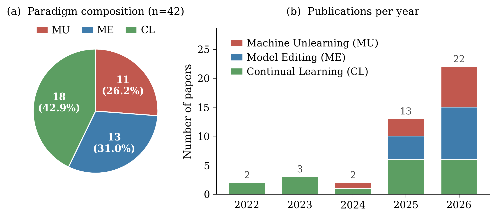
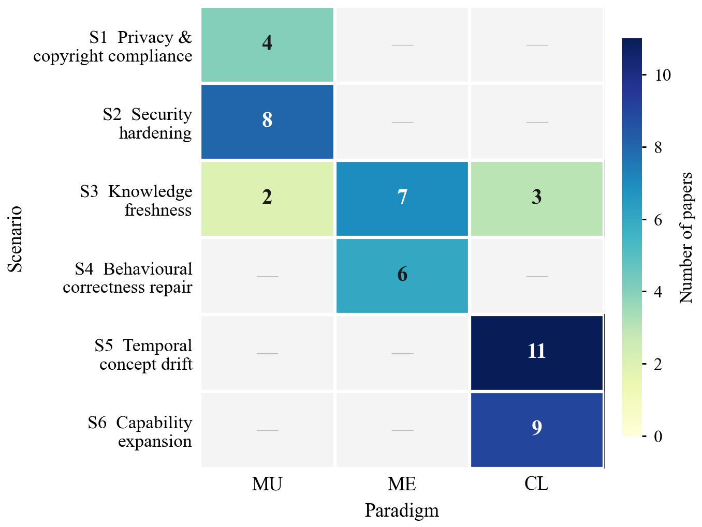

# Dynamic Model Evolution for Software Engineering

This repository accompanies the survey **Towards Adaptive Models for Software Engineering: A Survey of Dynamic Model Evolution via Machine Unlearning, Model Editing, and Continual Learning**.

It collects the 42 studies examined in the survey on machine unlearning, model editing, and continual learning for software engineering models, together with the per-study extraction and coding matrix used for the statistics reported in the paper. The survey organizes these studies by six evolution scenarios (S1--S6) and compares them through three evaluation dimensions (D1--D3).

**Paper collection cutoff: August 2026.**

---

## Table of Contents

- [Overview & Statistics](#overview--statistics)
- [Studies](#studies)
  - [Machine Unlearning (11)](#machine-unlearning-11)
  - [Model Editing (13)](#model-editing-13)
  - [Continual Learning (18)](#continual-learning-18)
- [Data files](#data-files)
- [License](#license)

---

## Overview & Statistics

<table>
  <tr>
    <td width="60%"><small><b>Temporal trend and paradigm composition</b></small> </td>
    <td width="40%"><small><b>Scenarios and paradigm mapping</b></small> </td>
  </tr>
</table>

The corpus contains 42 studies published between 2022 and 2026: 11 on machine unlearning, 13 on model editing, and 18 on continual learning. A study may carry more than one evolution scenario, yielding 50 scenario assignments in total; counts per scenario therefore refer to assignments rather than to disjoint sets of studies.

## Studies

### Machine Unlearning (11)

- [**ICSE 2026**] [Scrub It Out! Erasing Sensitive Memorization in Code Language Models via Machine Unlearning](https://doi.org/10.1145/3744916.3764573)
- [**AAAI 2026**] [Large Language Model Unlearning for Source Code](https://doi.org/10.1609/aaai.v40i37.40398)
- [**Neural Networks 2026**] [Mitigating Sensitive Information Leakage in LLMs4Code through Machine Unlearning](https://doi.org/10.1016/j.neunet.2026.108606)
- [**ICSME 2026**] [Towards Knowledge Alignment in Code LLMs: Contrastive Unlearning for Evolving APIs](https://arxiv.org/abs/2606.30810)
- [**arXiv 2025**] [When Forgetting Builds Reliability: LLM Unlearning for Reliable Hardware Code Generation](https://arxiv.org/abs/2512.05341)
- [**MLCAD 2025**] [SALAD: Systematic Assessment of Machine Unlearning on LLM-Aided Hardware Design](https://doi.org/10.1109/mlcad65511.2025.11189152)
- [**arXiv 2024**] [Unlearning Trojans in Large Language Models: A Comparison Between Natural Language and Source Code](https://arxiv.org/abs/2408.12416)
- [**AAAI 2025**] [Backdoor Token Unlearning: Exposing and Defending Backdoors in Pretrained Language Models](https://doi.org/10.1609/aaai.v39i23.34605)
- [**AAAI 2026**] [DUP: Detection-guided Unlearning for Backdoor Purification in Language Models](https://doi.org/10.1609/aaai.v40i37.40366)
- [**arXiv 2026**] [Backdoor Unlearning Generalization: A Path Toward the Removal of Unknown Triggers in LLMs](https://arxiv.org/abs/2606.03785)
- [**arXiv 2026**] [LLM Ghostbusters: Surgical Hallucination Suppression via Adaptive Unlearning](https://arxiv.org/abs/2605.01047)

### Model Editing (13)

- [**ISSTA 2026**] [Don't Use a Cannon to Kill a Fly: Lightweight Model Editing for LLMs to Correct Deprecated API Recommendations](https://arxiv.org/abs/2511.21022)
- [**ICSE 2025**] [Model Editing for LLMs4Code: How Far Are We?](https://doi.org/10.1109/icse55347.2025.00049)
- [**AAAI 2026**] [ReCode: Updating Code API Knowledge with Reinforcement Learning](https://doi.org/10.1609/aaai.v40i40.40683)
- [**TOSEM 2026**] [Neuron Patching: Semantic-based Neuron-level Language Model Repair for Code Generation](https://doi.org/10.1145/3799426)
- [**ICSE 2026**] [CREME: Robustness Enhancement of Code LLMs via Layer-Aware Model Editing](https://doi.org/10.1145/3744916.3773111)
- [**arXiv 2026**] [Mitigating Package Hallucinations in Large Language Models via Model Editing](https://arxiv.org/abs/2607.02052)
- [**arXiv 2025**] [Understanding Robustness of Model Editing in Code LLMs](https://arxiv.org/abs/2511.03182)
- [**arXiv 2025**] [CodeUpdateArena: Benchmarking Knowledge Editing on API Updates](https://arxiv.org/abs/2407.06249)
- [**ICML 2025**] [CodeSync: Synchronizing LLMs with Dynamic Code Evolution at Scale](https://arxiv.org/abs/2502.16645)
- [**ICSE 2026**] [A Semantic-based Optimization Approach for Repairing LLMs: Case Study on Code Generation](https://doi.org/10.1145/3744916.3773262)
- [**arXiv 2026**] [Diagnosing Knowledge Gaps in LLM Tool Use: An Agentic Benchmark for Novel API Acquisition](https://arxiv.org/abs/2606.03657)
- [**ICSE 2026**] [Environment-Aware Code Generation: How far are We?](https://doi.org/10.1145/3744916.3787784)
- [**ISSTA 2026**] [Understanding and Improving Model Editing for Secure Code Generation](https://arxiv.org/abs/2608.06848)

### Continual Learning (18)

- [**ICSE 2023**] [Keeping Pace with Ever-Increasing Data: Towards Continual Learning of Code Intelligence Models](https://doi.org/10.1109/icse48619.2023.00015)
- [**FSE 2023**] [On the Usage of Continual Learning for Out-of-Distribution Generalization in Pre-trained Language Models of Code](https://doi.org/10.1145/3611643.3616244)
- [**ISSTA 2022**] [CIRCLE : Continual Repair across Programming Languages](https://doi.org/10.1145/3533767.3534219)
- [**ACL 2023**] [Exploring Continual Learning for Code Generation Models](https://doi.org/10.18653/v1/2023.acl-short.68)
- [**COLM 2026**] [SkillLearnBench : Benchmarking Continual Learning Methods for Agent Skill Generation on Real-World Tasks](https://arxiv.org/abs/2604.20087)
- [**arXiv 2025**] [SWE-Bench-CL : Continual Learning for Coding Agents](https://arxiv.org/abs/2507.00014)
- [**MSR 2024**] [CodeLL : A Lifelong Learning Dataset to Support the Co-Evolution of Data and Language Models of Code](https://doi.org/10.1145/3643991.3644864)
- [**ICISSP 2026**] [Enhancing Continual Learning for Software Vulnerability Prediction: Addressing Catastrophic Forgetting via Hybrid-Confidence-Aware Selective Replay for Temporal LLM Fine-Tuning](https://arxiv.org/abs/2602.23834)
- [**arXiv 2025**] [CodeFlowLM: Incremental Just-In-Time Defect Prediction with Pretrained Language Models and Exploratory Insights into Defect Localization](https://arxiv.org/abs/2512.00231)
- [**SMC 2025**] [Offline and Continual Just-in-Time Software Defect Prediction with Pre-trained Language Models](https://doi.org/10.1109/smc58881.2025.11343039)
- [**USENIX Security 2026**] [Retrofit: Continual Learning with Controlled Forgetting for Binary Security Detection and Analysis](https://arxiv.org/abs/2511.11439)
- [**arXiv 2026**] [SWE-Chain: Benchmarking Coding Agents on Chained Release-Level Package Upgrades](https://arxiv.org/abs/2605.14415)
- [**IJCAI 2022**] [CERT: Continual Pre-training on Sketches for Library-oriented Code Generation](https://doi.org/10.24963/ijcai.2022/329)
- [**JSS 2026**] [CLVUL: A Contrastive Learning Framework for Unified Vulnerability Detection Localization and CWE Classification](https://doi.org/10.1016/j.jss.2026.112917)
- [**IST 2025**] [Exploring Continual Learning in Code Intelligence with Domain-wise Distilled Prompts](https://doi.org/10.1016/j.infsof.2025.107775)
- [**JSS 2025**] [Learning Never Stops: Improving Software Vulnerability Type Identification via Incremental Learning](https://doi.org/10.1016/j.jss.2025.112544)
- [**Computers & Security 2025**] [Towards Prompt Tuning-based Software Vulnerability Assessment with Continual Learning](https://doi.org/10.1016/j.cose.2024.104184)
- [**arXiv 2026**] [Code2LoRA: Hypernetwork-Generated Adapters for Code Language Models under Software Evolution](https://arxiv.org/abs/2606.06492)

## Data files

| File | Content |
|---|---|
| `data/machine-unlearning.csv` | Per-study record for the 11 machine unlearning studies |
| `data/model-editing.csv` | Per-study record for the 13 model editing studies |
| `data/continual-learning.csv` | Per-study record for the 18 continual learning studies |

The three files share one schema and together form the study-level extraction matrix. Main columns:

| Column | Content |
|---|---|
| `id`, `short_name`, `title`, `link`, `year`, `venue`, `venue_type` | Bibliographic record; the year follows the cited publication version |
| `paradigm` | Machine unlearning (MU), model editing (ME), or continual learning (CL) |
| `contrib` | Contribution type: method, empirical study, benchmark, or dataset |
| `se_task` | Software engineering task evaluated in the study |
| `scenario` | Evolution scenario labels S1--S6; multiple labels are separated by `;` |
| `tech_family` | Technique family assigned under the paradigm's mechanism classification |
| `target`, `setting`, `core_idea` | Update target, experimental setting, and main mechanism |
| `base_models`, `baselines`, `metrics`, `benchmark` | Backbone models, compared baselines, measures, and evaluation resources |
| `metrics_display` | Measures as reported in the paper |

Within each dimension a study is counted once per label. Studies that only contribute data or benchmarks carry no update method of their own and are recorded accordingly.

## License

Released under the MIT License; see [LICENSE](LICENSE).
